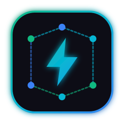

# ⚡ AgentForge: Autonomous Multi-Agent Org & Live Web Dashboard

> **Turn Google Antigravity into an autonomous software company with 7 specialized agents, automated pipeline handoffs, and a real-time multi-project web command center.**



---

## 🌟 Overview

**AgentForge** is an open-source, production-grade Antigravity plugin that packages a complete autonomous software development workforce. Each agent specializes in one core domain of the engineering lifecycle, coordinating work in parallel and reporting to a unified real-time dashboard.

### 👥 The 7 Specialized Agents

| Slash Command | Role | Responsibility |
| :--- | :--- | :--- |
| **`/agent-pm`** | **Product & Project Manager** | Scopes initiatives, breaks goals into PRDs and user stories with Given-When-Then criteria, and defines MVP boundaries. |
| **`/agent-watcher`** | **Task Assigner & Watcher** | Central pipeline orchestrator. Watches active tasks, auto-transitions work between agents, and manages quality feedback loops. |
| **`/agent-planner`** | **Planner & R&D Architect** | Deep technical research, library/API spikes, architectural trade-offs, ADRs, and phased execution roadmaps. |
| **`/agent-coder`** | **Senior Software Engineer** | Clean, idiomatic, defensive implementation, strict type safety, error boundaries, and surgical refactoring. |
| **`/agent-tester`** | **QA & Test Automation** | Designs unit, integration, and E2E test suites, tests boundary/adversarial edge cases, and diagnoses test failures. |
| **`/agent-reviewer`** | **Code Reviewer & Security** | OWASP Top 10 static security audits, concurrency race conditions, memory leaks, and triage (`[BLOCKER]`, `[MAJOR]`, `[SUGGESTION]`). |
| **`/agent-reality`** | **Real-Life Insights Advisor** | Real-world reality check: Day-2 operational maintenance, human adoption friction, and cloud cost sanity. |
| **`/agent-dashboard`** | **Command Center** | Launches and views the live multi-project web dashboard with real-time sync and human-in-the-loop controls. |

---

## 🚀 The Production Pipeline

```
                     👑 HUMAN SUPERVISOR (You)
                                 │
                                 ▼
                     [ 👔 Product Manager (PM) ]
                                 │ (PRD & Scoping)
                                 ▼
              [ 🛰️ Task Watcher & Project Assigner ]
                                 │
         ┌───────────────────────┼───────────────────────┐
         ▼                       ▼                       ▼
  [ 🧭 Planner & R&D ]    [ ⚡ Coder (Dev) ]      [ 🧪 Tester (QA) ]
         │                       │                       │
         └───────────────────────┼───────────────────────┘
                                 ▼
                   [ 🔍 Code Reviewer & Security ]
                                 │
                                 ▼
                  [ 🛡️ Real-Life Insights Advisor ]
                                 │
                                 ▼
                        [ 🚀 Shipped / Done ]
```

---

## 🖥️ Live Multi-Project Web Dashboard

AgentForge includes an embedded real-time web command center (`http://localhost:3333`):

- **📁 Project Selector (Top Right)**: Filter the live board by specific project (`📁 experiments`, `📁 VoiceNotes`, etc.) or view all projects together (`🌐 All Projects`).
- **🔍 Deep Task Details**: View real-time stage progress, detailed description of the exact sub-step currently being worked on, and the initiating source (`👤 Human` vs `🤖 Agent` vs `⚡ Automated Pipeline`).
- **👑 Human-in-the-Loop Interventions**:
  - Click **"Intervene"** on any active task to inject direct guidance into the agent prompt.
  - Force reroute tasks (e.g. force to Dev, force to QA, or reject review and loop back to coder).
  - Reprioritize or terminate tasks with executive authority.
- **⚡ Zero Dummy Data**: Only tracks real active workstreams across your workspaces.

---

## 📦 How to Install (For Others)

### Option 1: 1-Click Installer (Recommended)

#### On Windows (PowerShell):
```powershell
irm https://raw.githubusercontent.com/<your-username>/agentforge-plugin/main/scripts/install.ps1 | iex
```
*Or locally:*
```powershell
./scripts/install.ps1
```

#### On macOS / Linux (Bash):
```bash
curl -fsSL https://raw.githubusercontent.com/<your-username>/agentforge-plugin/main/scripts/install.sh | bash
```
*Or locally:*
```bash
./scripts/install.sh
```

---

### Option 2: Manual Plugin Installation

#### Global Installation (Available across all your projects):
1. Copy or clone this folder into your global Antigravity plugins directory:
   - **Windows**: `%USERPROFILE%\.gemini\config\plugins\agentforge\`
   - **macOS/Linux**: `~/.gemini/config/plugins/agentforge/`
2. Restart Antigravity or open a new session.

#### Workspace-Only Installation (For a specific repository):
1. Copy this folder into your project root:
   - `<project-root>/.agents/plugins/agentforge/`
2. Commit to Git so your entire team gets the 7 agents and dashboard automatically.

---

## 🌐 How to Publish to the World

### 1. Publish to GitHub
1. Create a new GitHub repository named `agentforge-plugin`.
2. Push this folder to your repository:
   ```bash
   git init
   git add .
   git commit -m "feat: initial AgentForge autonomous multi-agent plugin"
   git branch -M main
   git remote add origin https://github.com/<your-username>/agentforge-plugin.git
   git push -u origin main
   ```
3. Create a GitHub Release and attach the pre-packaged `agentforge-plugin.zip`.

### 2. Publish to the Antigravity Agent Marketplace
To distribute your plugin to thousands of Antigravity developers:
1. Ensure your `plugin.json` has valid `name`, `displayName`, `version`, `author`, and `description`.
2. Run the packaging command to generate a release archive:
   ```bash
   node ./scripts/package.js
   ```
3. Submit a pull request to the official Agent Marketplace catalog or add the release URL to your team's `plugins.json`.

---

## 📂 Plugin Directory Structure

```text
agentforge-plugin/
├── plugin.json         # Manifest marker declaring the plugin
├── hooks.json          # Global lifecycle hook for automatic cross-project telemetry
├── README.md           # User documentation
├── LICENSE             # MIT Open Source License
├── assets/
│   └── logo.svg        # 256x256 high-contrast SVG logo
├── rules/
│   └── AGENTS.md       # Operational multi-agent pipeline rules
├── agents/             # Custom agents definitions (dual-role main & subagents)
│   ├── agent-pm.md
│   ├── agent-watcher.md
│   ├── agent-planner.md
│   ├── agent-coder.md
│   ├── agent-tester.md
│   ├── agent-reviewer.md
│   └── agent-reality.md
├── skills/             # First-class slash command skills
│   ├── agent-pm/SKILL.md
│   ├── agent-watcher/SKILL.md
│   ├── agent-planner/SKILL.md
│   ├── agent-coder/SKILL.md
│   ├── agent-tester/SKILL.md
│   ├── agent-reviewer/SKILL.md
│   ├── agent-reality/SKILL.md
│   └── agent-dashboard/SKILL.md
├── dashboard/          # Self-healing web dashboard server & client
│   ├── index.html      # Responsive Tailwind web interface with project selector
│   ├── server.js       # Lightweight zero-dependency HTTP & SSE stream server
│   ├── track.js        # Self-healing cross-project telemetry CLI
│   ├── hook-preinvocation.js # Automatic prompt interceptor
│   └── state.json      # Persistent local state (zero mock data)
└── scripts/            # Installer and packaging scripts
    ├── install.ps1     # 1-click Windows installer
    ├── install.sh      # 1-click macOS/Linux installer
    └── package.js      # ZIP release packaging utility
```

---

## 📄 License

MIT License — see [LICENSE](./LICENSE) for details. Built for the Google Antigravity developer community.
